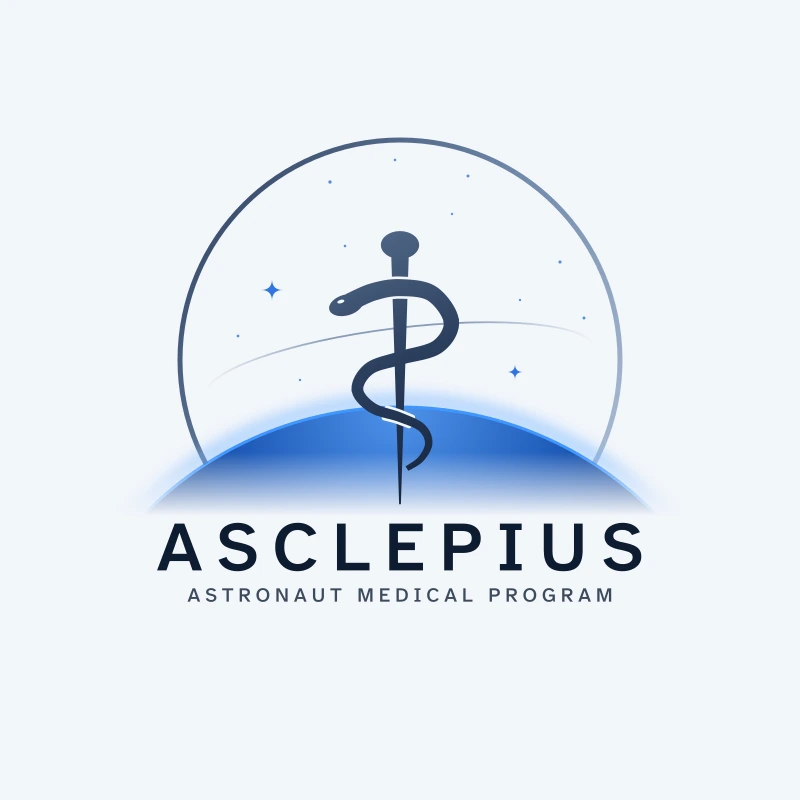

<p align="center">
  <picture>
    <source media="(prefers-color-scheme: dark)" srcset="frontend/public/brand/logo-dark.webp">
    
  </picture>
</p>

<h1 align="center">Asclepius: an explainable health expert system for astronauts</h1>

<p align="center">
  <b><a href="https://asclepius.phronesisco.tech">Live demo</a> · <a href="https://youtu.be/nKgauD-4YBg">Demo video</a> · <a href="https://www.spaceappschallenge.org/2026/find-a-team/bubliki/">Team Bubliki</a></b><br>
  NASA Space Apps Challenge 2026<br>
  Challenge: <i>Create Health Monitoring Software for Astronauts on Space Missions</i>
</p>

> Decision support for crew self-assessment. Not a medical diagnosis.

## The problem

On long missions astronauts have to notice health changes themselves. On the way to Mars the flight surgeon is up to 20 minutes
away; behind the Moon there is no link at all. Astronaut health records are not public, so there is nothing to train a model on.

## What Asclepius does

Instead of a black-box model, Asclepius turns NASA's medical knowledge into clear IF-THEN rules. It:

1. collects indicators: vitals, sleep, mood, symptoms, reaction time, cabin CO2, radiation dose;
2. compares them with the astronaut's **own six-month pre-flight passport**, not with population averages;
3. runs **transparent rules** and returns hypotheses with a confidence %, an urgency level (GREEN, YELLOW, ORANGE, RED)
   and a **"Why?"** chain that names the rule and its NASA source;
4. tells the crew what to do now and which **measurement to take next** when data is missing;
5. on RED, builds a compact **flight-surgeon packet**; with a long delay or no link it puts onboard steps first and queues the packet
   until the link returns.

### In numbers

| | |
|---|---|
| Knowledge base | 60+ indicators, 115 conditions (all 100 of NASA's Integrated Medical Model plus 15 from HRP evidence), 220+ documented rules, 100+ references |
| Rule engine | 86 rules encoded and running, forward chaining, MYCIN-style certainty factors, red-flag guard, next best measurement |
| Crew passports | 5 fictional crew members, each with a six-month pre-flight dossier built from real people's data, every value labelled with its source |
| Validation | the engine was run on real data: healthy volunteers, real astronaut lab draws, emergency patients, CGM, tilt tests (see below) |

## Using the app

Open the [live demo](https://asclepius.phronesisco.tech) or run it locally (below). The header switch chooses **Demo** or **My crew**.

### Demo: Hygieia I, day by day

A fictional mission with a fictional four-person crew: the Panacea capsule on a ten-day free-return lunar flyby. The slider in the dock
moves through the flight days. Every crew member has morning and evening check-ins for all ten days; **Check-in** opens the selected
day's report (editable) and *Start new day* adds day 11.

| Day | Event | Result |
|---|---|---|
| 1 | Launch, Van Allen belt pass | Pilot YELLOW motion sickness; others GREEN |
| 2 | Space adaptation syndrome | Pilot: headache, congestion, nausea, back pain read as GREEN "expected adaptation", plus YELLOW motion sickness 95% (passport: sick on a previous flight) |
| 3 | Low fluid intake | MS-2 (kidney-stone history) YELLOW dehydration |
| 4 | Solar particle event (a real NASA DONKI event, replayed) | Whole crew ORANGE: shelter; dose jumps |
| 5 | Possible radiation sickness | MS-1 nausea and fatigue 26 h after the flare: RED, asks for a lymphocyte count, packet |
| 6 | Far side, loss of signal | MS-2 flank pain: RED kidney stone, packet **queued** until the link returns |
| 7 | Cabin CO2 3.4 mmHg | Pilot YELLOW CO2 headache; whole crew YELLOW |
| 8 | Sleep debt | Commander YELLOW: third night under 6 h |
| 9 | Fatigue before re-entry | Commander ORANGE fatigue impairing performance 95% (KSS 7, PVT 312 ms) |
| 10 | Re-entry and splashdown | MS-2 BP 88/56 with dizziness: ORANGE orthostatic intolerance, RED NEWS2 |

All in-flight values are illustrative. No blood labs are invented (no blood is drawn on this flight).

On every screen: a clickable body map, the assessment with "Why?", morning and evening check-ins, the crew roster, the full-screen
**six-month passport** (baseline tiles, every series, all pre-flight sessions and fields with provenance) and **Health dynamics**
charts (every metric on one axis from L-180 through launch to the current mission day, with baseline, personal range, thresholds,
7-day mean and crew comparison).

### My crew

Register your own crew members (the passport quiz asks for name, history and modifiers), then run their daily check-ins.
New members have no six-month passport, so the backend starts them on population baselines; after 7 days of check-ins the engine
switches to each member's own median. The crew lives only in your browser (`localStorage`); nothing is stored on the server.

**Import and Export** (in the dock):

| File | What it gives the member |
|---|---|
| Wide CSV: `day` or `date`, then one column per metric (`hr_rest, hrv_rmssd, sleep_hours, spo2, body_mass, pvt_rt, ...`; common names like `Resting HR`, `weight (lb)`, `temp (F)` are recognised) | Rows before launch (day -180 to -1) become the six-month passport; rows from mission day 1 become check-ins |
| Long CSV: `day, metric, value, unit, ref_lo, ref_hi` | The same, one value per row; labs can bring their own reference ranges |
| Passport JSON (the `data/passports/*.json` format) | The passport as is, provenance kept |
| Crew backup JSON (from Export) | Every member with check-ins and imported data |

Units are converted where known (F, lb, minutes of sleep, mmol/L glucose). Values outside plausible ranges are skipped and listed,
never clipped. Templates: `frontend/public/import-templates/`.

## How the reasoning works

1. **Facts**: latest values, personal baselines (passport first, then the median of prior days once there are 7), streaks, 7-day counts,
   NEWS2, qSOFA, mission context (day, delay, link, dose).
2. **Rules** fire in a loop until nothing new appears. Several rules for one hypothesis combine as `CF = a + b(1 - a)`.
3. **Guard**: "expected adaptation" never hides a red flag in the same body system.
4. **Missing data is never normal**: rules with missing inputs stay *pending* and drive the next best measurement; a body region with
   no data shows "not assessed", never green.
5. **Packet**: RED only; onboard actions first when the delay is over 5 minutes or there is no link.

## Data

No public time series of astronaut vital signs exist, so each fictional crew member's pre-flight passport is built from **real donors**:
real astronaut labs, real population exams and real people's wearable streams, matched by sex and age. One donor is never shared by two
crew members, and nobody is identified. The pipeline (`pipeline/`) downloads the sources, builds the tables in `data/` and is
deterministic (same inputs, byte-identical outputs). The backend only reads the committed outputs and never touches the network.

### Every value says where it comes from

| Label | Meaning | Example |
|---|---|---|
| `real-astronaut` | Measured on a real, de-identified astronaut | Inspiration4 hemoglobin at L-3 |
| `real-ground` | Measured on a real person on Earth | LifeSnaps resting HR, HRV, sleep, mood |
| `real-population` | A real participant record from a population survey | NHANES DXA, audiogram, blood pressure, PHQ-9 |
| `synthetic-calibrated` | Generated by a model whose parameters come from real data or publications | days before a donor's record starts, PVT from published norms |
| `authored` | Set by the fictional character's story | medical history, preferences |

### Sources

| Source | What we use |
|---|---|
| **NASA OSDR OSD-569 / OSD-575** (Inspiration4 labs) | all 4 crew, 7 draws (L-92 to R+194): 20 CBC and 16 CMP analytes with lab reference ranges, CRP |
| **NASA OSDR OSD-572** (Inspiration4 metagenomes) | oral, nasal and skin microbiome diversity at L-92, L-44, L-3 |
| **NASA OSDR OSD-410** (GEO GSE63952) | 20 radiation-responsive genes for a biodosimetry model (`data/warehouse/biodosimetry_model.json`) |
| **NASA DONKI** | 179 solar energetic particle events 2024-2025; the demo replays `2024-05-10T13:35:00-SEP-001` |
| **NASA evidence** (`data/evidence/`) | NASA-STD-3001 and OCHMO limits, in-flight shifts from HRP evidence reports, IMM and ISS incidence |
| **NOAA SWPC** | 262 solar proton events 1976-2017 |
| **MSL RAD, Chang'e-4 LND** | published dose rates: Mars transit, Mars surface, lunar surface |
| **NHANES 2011-2012 and 2003-2004** (CDC, public domain) | one-off exams per crew member; population percentiles; balance test |
| **LifeSnaps** (Zenodo, CC BY 4.0) | 180 days of resting HR, HRV, sleep, steps, SpO2, mood, personality |
| **MMASH** (PhysioNet, ODbL) | saliva cortisol and melatonin, PSQI, chronotype |
| **PTB-XL** (PhysioNet, CC BY 4.0) | one normal 12-lead ECG per crew member, matched by sex and age |
| **PhysioNet head-up tilt** | supine and tilt BP and HR of healthy controls |
| **MIMIC-IV-ED demo, BIG IDEAs CGM** | validation only |

URL, licence and status of every source: `data/catalog.yaml`. Metric names and units: `data/metrics.yaml`.

### What is in `data/`

- `passports/<crew>.json`: the six-month pre-flight dossier (L-180 to L-1): daily wearable streams and check-ins, weekly and monthly
  tests, 25 sessions on the NASA reference schedule (DXA, VO2peak, cognition, labs, quarantine) and about 90 passport fields. Each field has
  a value, personal range (p10 to p90) or lab range, completeness, readiness, method, provenance and sources. Fields whose source is not
  loaded are marked `missing`, never "normal".
- `warehouse/`: `sources`, `subjects`, `observations` (long format with provenance and quality), `crew_donors`, `sessions`,
  `passport_fields`, `events`, `evidence`, `population_norms`, `environment`.
- `crew/*.yaml`: the fictional crew's stories and modifiers. `evidence/*.csv`: NASA limits, space effects, incidence, norms, dose rates.
- `inspiration4/`, `osd-410/`, `space_weather/`: the source files we read, untouched.

Raw downloads (about 1 GB, some files over GitHub's 100 MB limit) are not committed: `python -m pipeline fetch` gets them into `data/raw/`.

Flight days continue each member's real pre-flight series (resting HR and HRV follow an AR(1) model of the donor's own data), and the
engine also gets the expected NASA in-flight shift for each metric (for example systolic BP -8 mmHg), so normal adaptation is not
flagged as illness.

### Inspiration4 corrections

The files in `data/inspiration4/` stay untouched; `pipeline/inspiration4.py` fixes known errors and tags them in
`observations.quality` (`corrected`, `derived` or `suspect`):

- C003 at L-92 (CBC): MCH is missing, so every value after MCV sits one column to the right. Re-aligned and checked (Hb/RBC, Hb/Hct,
  differential x WBC); basophils derived.
- Blank red-cell indices are derived from the same draw (MCHC = Hb/Hct x 100, MCV = Hct/RBC x 10, MCH = Hb/RBC x 10).
- C003 is female (OSD-575 metadata) but has male reference ranges at L-92, L-44 and L-3: her own female post-flight ranges are used.
- R+45: glucose 36 to 44 mg/dL in three crew at one draw, one also with potassium 5.9: kept as published, flagged as likely sample
  handling and not fed to the rules.
- "NA" and blank cells are never read as zero.

## Validation on real data

`python -m pipeline.validate` runs the real rule engine on real data. Full report: [`data/validation.md`](data/validation.md).

| Check | Result |
|---|---|
| False alarms on healthy people (LifeSnaps, 23 people, 1,276 days) | 92% GREEN, 0 RED; most YELLOW days are sleep under 6 h, which matches NASA's own restricted-sleep threshold |
| Real astronaut lab draws (Inspiration4, 28 draws) | 4 draws trigger the glucose rules; flagged for flight-surgeon review (the bands are written for treated diabetes) |
| Emergency patients from triage vitals only (MIMIC-IV-ED demo, 199 stays) | 27% of urgent patients escalated to ORANGE or RED from vitals alone; the rest need symptoms, which the check-in collects |
| Orthostatic criteria (PhysioNet tilt, 20 healthy controls) | 0 false positives, so a positive test on landing day is meaningful |
| Biodosimetry from blood gene expression (OSD-410, 100 samples) | 64% accuracy for none / low / high dose (chance 33%); exposure detected in 84%, unexposed recognised 25 of 25 |

## Run it locally

Requirements: **Python 3.10 or newer** (tested with 3.13 and 3.14) and **Node 18 or newer**.

```bash
# backend
cd backend
python3.13 -m venv .venv
.venv/bin/pip install -r requirements.txt
.venv/bin/python -m pytest tests -q
.venv/bin/python -m uvicorn app.main:app --port 8000
```

```bash
# frontend (second terminal)
cd frontend
npm install
npm run dev          # http://localhost:5173, proxies /api to :8000
```

Optional, rebuild the data (Python 3.13; the built outputs are already committed):

```bash
python3.13 -m venv pipeline/.venv && pipeline/.venv/bin/pip install -r pipeline/requirements.txt
pipeline/.venv/bin/python -m pipeline all        # fetch raw sources, build data/warehouse and data/passports
pipeline/.venv/bin/python -m pipeline.validate   # rule engine on real data, writes data/validation.md
```

### API

| Method | Path | |
|---|---|---|
| GET | `/api/scenarios`, `/api/scenarios/{id}` | demo scenarios |
| POST | `/api/assess` | assess a passport and check-in history |
| POST | `/api/passport/derive` | passport from quiz answers |
| POST | `/api/import/parse` | parse and validate an imported file |
| GET | `/api/crew`, `/api/crew/{id}/passport` | crew and six-month passports |
| GET | `/api/knowledge`, `/api/datasets` | rules, conditions, sources |
| GET | `/api/space-weather/sep` | solar particle events |
| GET, POST | `/api/biodosimetry`, `/api/biodosimetry/classify` | gene-expression dose model |

Invalid input returns 422.

## Project layout

```
backend/          FastAPI rule engine and API (Python)
  app/            engine, facts, NEWS2, passport, importer, flight-surgeon packet
  knowledge/      encoded rules, conditions, actions and references (YAML)
  tests/          engine, API, data and import tests
frontend/         web app (React 18, TypeScript, Vite, Recharts)
pipeline/         data pipeline: fetch sources, build the warehouse and passports, validate
data/             datasets, crew passports, NASA evidence tables, validation report
knowledge-base/   the expert system's knowledge: passport, check-ins, indicators, conditions, rules, actions, references
```

The knowledge base in `knowledge-base/` is the source of the rules: every rule has an ID, certainty factor, urgency level, actions and
cited references (`knowledge-base/08-references.md`). The backend reads it directly for the passport fields.

## Limits and safety

- In-flight demo vitals are synthetic, built from NASA limits and clinical scores. Pre-flight passports use real donors.
- NASA does not publish in-flight alarm thresholds for most vital signs; those come from clinical scores (NEWS2, AHA, ADA) and are labelled.
- No drug doses: medication always says "per onboard medical checklist / CMO".
- Certainty factors and thresholds marked `[T]` in the knowledge base are team choices to be reviewed by a flight surgeon.
- The demo mission (Hygieia I, Panacea capsule) and its crew are fictional. Real missions appear only as data sources and citations.

## AI disclosure

The idea and all design decisions are the team's own. AI tools were used under the team's direction:

- **Code and knowledge base**: an AI coding assistant helped collect and summarise NASA resources, draft the knowledge-base tables
  and write the code. Every rule cites its source.
- **Data**: the fictional crew (`data/crew/`), the illustrative in-flight values and every value labelled `synthetic-calibrated`
  were produced by code written with the assistant. Values labelled `real-astronaut`, `real-ground` or `real-population` come from
  the cited datasets as published (corrections are listed above).
- **Logo**: the first concept was an image generated with ChatGPT. The logo in the app and in this repository is a flat vector
  redrawing of it (`frontend/public/brand/logo-dark.svg`, `logo-light.svg`); the generated image is no longer used in the app.
- **Demo video**: the narration is an AI-generated voice (open-source Kokoro-82M text-to-speech, run locally, reading the team's
  script). The app shots are screen recordings of the running app; the other graphics are vector animations rendered by code.
